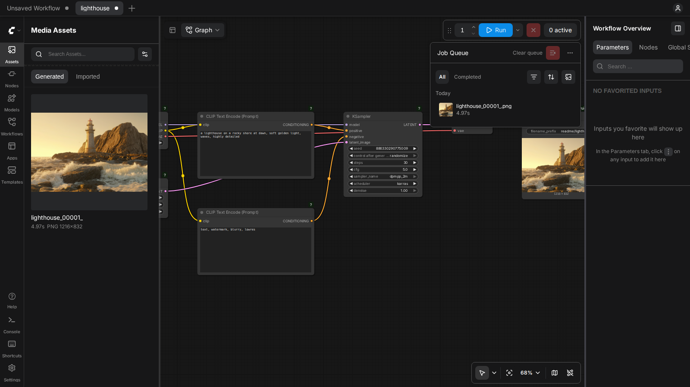
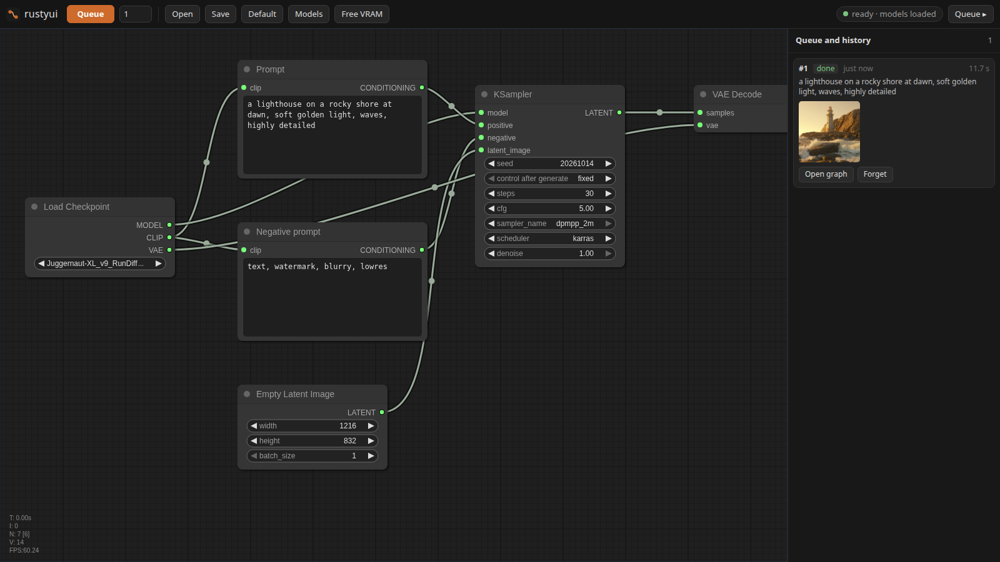

<div align="center">

# rustyui

**A ComfyUI-compatible diffusion engine, written in Rust on [candle](https://github.com/huggingface/candle).**



</div>

rustyui runs ComfyUI's node graphs on the GPU without Python, PyTorch or ComfyUI installed. It
answers ComfyUI's HTTP API and websocket, reads a models folder laid out like ComfyUI's, and writes
pictures and videos that carry their graph the way ComfyUI's do. A graph rendered in rustyui and in
ComfyUI gives the same output: for the graphs listed in [How it matches ComfyUI](#how-it-matches-comfyui),
the same pixels, bit for bit, on the reference setup described there.

rustyui is an independent project, not affiliated with or endorsed by Comfy-Org (see
[Relationship to ComfyUI](#relationship-to-comfyui)).

It is two programs, like ComfyUI:

- **`rustyui-backend`** (`backend/`) loads the models, runs the graphs, answers the API and serves
  the editors, all from one binary on `http://127.0.0.1:8190`.
- **The editors**, compiled into that binary:
  - `ui/`, at `/`: Comfy-Org's [ComfyUI_frontend](https://github.com/Comfy-Org/ComfyUI_frontend)
    v1.55.14, vendored essentially unmodified (parts rustyui does not use are removed; see
    [THIRD_PARTY_NOTICES.md](THIRD_PARTY_NOTICES.md)). The queue and assets panels, progress on the nodes,
    cancelling, uploads, the model library, settings and saved workflows work as they do on ComfyUI.
  - `frontend/`, at `/simple/`: a smaller editor in the layout of Stable Diffusion WebUI Forge
    (txt2img, img2img, PNG Info), with a node-graph view at `/simple/#graph`.

## Status

rustyui is a work in progress. It is developed and tested on Linux with NVIDIA GPUs (compute
capability 8.9, mostly an RTX 4090 and an RTX 4070 Ti SUPER); other setups are untested.

- **Works today:** SDXL (text to image, img2img, inpainting, the hires fix, LoRAs, embeddings,
  ControlNet and the other nodes listed under [Supported nodes](#supported-nodes)), ComfyUI's API
  and both editors, and the LTX-2.3 workflows described under
  [How it matches ComfyUI](#how-it-matches-comfyui), checked against ComfyUI as described there.
- **Partial:** LTX-2.3 (CFG above 1 does not run with guides yet; `t2v` from the command line is
  silent) and Anima (implemented, not yet checked against ComfyUI).
- **Not there yet:** other model families (SD 1.5, SD3, Flux and so on), any node not listed, and
  anything that is not Linux and NVIDIA. See [Limitations and roadmap](#limitations-and-roadmap).
- There are no release binaries; it is built from source. Expect rough edges and changes.

## Quick start

The short version; [Installing](#installing) has the details and the build variables.

1. **Requirements.** Linux x86-64, an NVIDIA GPU of compute capability 8.9, the CUDA 12.9 toolkit,
   cuDNN 9.19, Intel MKL and IPP ICV (downloaded by you), Rust 1.99.0 (pinned by
   `rust-toolchain.toml`), cmake, Node.js 20 or newer, pnpm 11 and bun. The pinned container in
   [`dev/`](dev/README.md) provides all of them.
2. **Build.**
   ```bash
   git clone https://github.com/gabeparra/rustyui.git && cd rustyui
   (cd ui && pnpm install --frozen-lockfile && pnpm exec vite build --config vite.config.mts)
   (cd frontend && bun install --frozen-lockfile && bun run build)
   cargo build --release
   ```
3. **Models.** Put your model files in a folder laid out like ComfyUI's `models/` (`checkpoints/`,
   `loras/`, `vae/` and so on; see [Supported models](#supported-models)), or point rustyui at an
   existing ComfyUI `models/` folder.
4. **Run.**
   ```bash
   ./target/release/rustyui-backend serve --models /path/to/ComfyUI/models --out /path/to/output
   ```
5. **Open** http://127.0.0.1:8190 for ComfyUI's editor, or http://127.0.0.1:8190/simple/ for the
   simple one.

On a card with less memory, `--no-video` leaves the video nodes out; one model is held in VRAM at
a time.

## Features

- **ComfyUI's formats.** Opens and saves ComfyUI workflows and API graphs. Every PNG carries
  ComfyUI's `prompt` text chunk, and `workflow` when the editor sends one, so a picture dropped on
  either editor, or on ComfyUI, reopens its graph.
- **ComfyUI's API.** `/prompt`, `/queue`, `/history`, `/jobs`, `/object_info`, `/view`,
  `/upload/image`, `/interrupt`, `/free` and the rest, also under `/api/`, plus the websocket
  `/ws` with ComfyUI's events. Existing clients and scripts work unchanged.
- **ComfyUI's results.** Seeds, prompt weighting, sigma schedules, samplers, LoRA folding,
  upscaling and VAE rounding follow ComfyUI's arithmetic, kernel for kernel where it matters.
- **SDXL, end to end.** Text to image, img2img, inpainting, the hires fix, LoRAs, textual-inversion
  embeddings, regional prompts and per-prompt LoRA hooks, ControlNet, a detailer, tiled prompts.
- **LTX-2.3 video (in progress).** Text to video and image to video with sound, through ComfyUI's
  own LTX nodes, guides, latent upscalers and LoRAs.
- **Custom node packs, ported natively.** Selected nodes from KJNodes, ComfyUI-Frame-Interpolation,
  comfyui_controlnet_aux, ComfyUI-RMBG, ComfyUI-Impact-Pack and ComfyUI-TiledAttentionCouple, in
  Rust, under their own names.
- **Light on the machine.** One model in VRAM at a time, weights memory-mapped, models unloaded
  after 90 s without work. Under systemd socket activation the process starts on the first
  request and exits when idle.
- **Loopback only.** Listens on `127.0.0.1` and refuses cross-site, DNS-rebinding and
  foreign-origin requests from browsers.
- **Optional prompt writer.** Point `--writer` at any GGUF Gemma 3 instruct model and the backend
  turns a short idea into a full tag-style prompt, on the same GPU. With a 12B Q6_K file it needs about 10 GB
  of GPU memory (measured on an RTX 4090).

## Examples

<table>
<tr>
<td width="50%"><a href="docs/examples/lighthouse.png"></a></td>
<td width="50%"><a href="docs/examples/lighthouse-hires.json"></a></td>
</tr>
<tr>
<td><a href="docs/examples/lighthouse.png"><code>lighthouse.png</code></a>: an SDXL checkpoint
(Juggernaut XL v9), 1216x832, dpmpp_2m karras, 30 steps. The PNG holds its graph: drop it on
either editor, or on ComfyUI. It is rustyui's render on an RTX 4090; ComfyUI 0.39.0 (default
flags) rendered the same graph with the same checkpoint file to identical pixels, all 1,011,712
of them.</td>
<td><a href="docs/examples/lighthouse-hires.json"><code>lighthouse-hires.json</code></a>: the same
with a hires fix (Remacri x4, lanczos down to 1824x1248, a second pass at denoise 0.4), as an API
graph. The picture is rustyui's render at half size (912x624); at 1824x1248 it too was identical
to ComfyUI's, all 6,829,056 values.</td>
</tr>
</table>


Image to video with LTX-2.3 from the same picture:

```bash
rustyui-backend i2v docs/examples/lighthouse.png "Waves roll in and break against the rocks below the \
lighthouse as the dawn light slowly brightens. Gulls glide past the tower. The camera holds still." \
  --width 640 --height 448 --frames 153 --seed 42
```

153 frames at 30 fps, 27 s on an RTX 4090 from the command to the MP4 (shown above at half the
frame rate, 480 px wide).

The [`examples/`](examples) folder holds ComfyUI API graphs for text to image, LoRA and a hires-fix
pass. Change `ckpt_name` and `lora_name` to files you have.

## Supported models

| Model | Status |
|---|---|
| SDXL checkpoints, including fine-tunes | Supported |
| kohya-format LoRAs (SDXL; LTX-2.3 DiT) | Supported, under the model's own module names or diffusers' |
| Textual-inversion embeddings (SDXL) | Supported |
| ESRGAN-family upscalers, old layout (such as Remacri) | Supported |
| SDXL ControlNets in diffusers' layout | Supported; Union ProMax is the one checked against ComfyUI |
| Depth Anything V2 (Small, Base, Large) | Supported, as comfyui_controlnet_aux's preprocessor |
| SAM 3 | Supported, as ComfyUI-RMBG's SAM3Segment |
| RIFE 4.7 and 4.9 | Supported, as ComfyUI-Frame-Interpolation's RIFE VFI |
| LTX-2.3 audio-video (distilled DiT, Gemma 3 text encoder, video and audio VAEs, latent upscalers) | In progress: the workflows below match ComfyUI; CFG above 1 with guides does not run yet |
| Anima (DiT, Qwen3-0.6B text encoder, Wan 2.1 VAE) | In progress: implemented, not yet checked against ComfyUI |
| Gemma 3 instruct, GGUF | Optional, for the prompt writer only |

Models are read from a folder laid out like ComfyUI's `models/`, by the names a graph uses:
`checkpoints/`, `loras/`, `embeddings/`, `upscale_models/`, `vae/`, `text_encoders/`, `clip/`,
`diffusion_models/` (or `unet/`), `controlnet/`, `latent_upscale_models/`, `depth_anything/`,
`sam3/sam3.pt`. Point rustyui at an existing ComfyUI install's `models/` and it finds everything
there. The `input/`, `temp/` and `user/` folders are read beside it, as ComfyUI keeps them.

The `t2v` and `i2v` commands load LTX-2.3 from fixed names:

| File | Use |
|---|---|
| `checkpoints/ltx-2.3-distilled.safetensors` | the distilled DiT |
| `checkpoints/ltx-2.3-text-projection.safetensors` | the text projection and connectors |
| `text_encoders/gemma_3_12B_it_fp4_mixed.safetensors` | Gemma 3, the text encoder |
| `vae/ltx-2.3-video-vae.safetensors` | the video VAE |
| `checkpoints/ltx-2.3-audio-vae.safetensors` | the audio VAE and vocoder |

In a graph, the loader nodes name the files, as in ComfyUI.

## Supported nodes

Each node is ComfyUI's, with the same class name, inputs, widget order, defaults and outputs. The
definitions the editors show come from ComfyUI's own `/object_info`
([`backend/assets/comfy_object_info.json`](backend/assets/comfy_object_info.json)), with the
choices cut to what rustyui runs. A graph with any other node is refused before it starts, with the
node's name. Widget inputs take links from INT, FLOAT, STRING and BOOLEAN outputs, as in ComfyUI.

**Images (SDXL)**

| Node | Notes |
|---|---|
| `CheckpointLoaderSimple` | SDXL checkpoints |
| `LoraLoader`, `LoraLoaderModelOnly` | any number, each at its own strength |
| `CLIPSetLastLayer`, `CLIPTextEncode`, `ConditioningConcat` | `(word:1.2)` weights, `embedding:name`, ComfyUI's 77-token chunks |
| `EmptyLatentImage`, `VAEEncode`, `VAEDecode` | |
| `KSampler` | samplers `euler`, `euler_ancestral`, `euler_ancestral_cfg_pp`, `dpmpp_2m`, `dpmpp_2m_sde`, `dpmpp_2m_sde_gpu`, `er_sde`; schedulers `simple`, `normal`, `karras`, `sgm_uniform`, `beta`; denoise below 1 |
| `LatentUpscale`, `LatentUpscaleBy` | `nearest-exact`, `bilinear` |
| `LoadImage`, `LoadImageMask`, `SetLatentNoiseMask` | img2img and inpainting |
| `UpscaleModelLoader`, `ImageUpscaleWithModel` | tiled 512 px with 32 px of overlap, as `comfy.utils.tiled_scale` |
| `ImageScale`, `ImageScaleBy` | `lanczos`, `bilinear` |
| `SaveImage` | ComfyUI's file naming and PNG text chunks |

**Masks, regions and hooks (SDXL)**

| Node | Notes |
|---|---|
| `SolidMask`, `MaskComposite`, `FeatherMask`, `GrowMask`, `InvertMask`, `MaskToImage`, `ImageToMask` | |
| `ConditioningCombine`, `ConditioningSetMask` | a prompt over part of the picture |
| `CreateHookLora`, `CreateHookLoraModelOnly`, `CombineHooks2`, `SetClipHooks`, `ConditioningSetProperties`, `ConditioningSetPropertiesAndCombine` | a LoRA for some prompts only. Not yet: mask bounds, timestep ranges, `schedule_clip` |

**ControlNet and preprocessors (SDXL)**

| Node | Notes |
|---|---|
| `ControlNetLoader`, `SetUnionControlNetType`, `ControlNetApplyAdvanced` | one control picture per apply; applies chain; start and end percent |
| `Canny` | as kornia runs it |
| `DepthAnythingV2Preprocessor` (comfyui_controlnet_aux) | checkpoint in `models/depth_anything/` or the pack's `ckpts/depth-anything/` |

**Detailing and tiled prompts (SDXL)**

| Node | Notes |
|---|---|
| `DifferentialDiffusion` | |
| `ImpactGaussianBlurMask`, `MaskToSEGS`, `DetailerForEach` (ComfyUI-Impact-Pack) | each masked region cut out, enlarged to the guide size, inpainted and pasted back. Not yet: wildcards, detailer hooks, inpaint models, tiled VAE passes, the SDE samplers' own noise |
| `TiledAttentionCouplePrompt`, `TiledAttentionCoupleShuffle`, `TiledAttentionCouple` (ComfyUI-TiledAttentionCouple) | a base prompt and one prompt per tile, split at `BREAK` |
| `SAM3Segment` (ComfyUI-RMBG) | masks for a text prompt from `models/sam3/sam3.pt`. Not yet: background Color, the CPU device |

**Video (LTX-2.3)**

| Node | Notes |
|---|---|
| `LTXAVTextEncoderLoader`, `UNETLoader`, `VAELoader`, `LTXVAudioVAELoader`, `LoraLoaderModelOnly` | |
| `CLIPTextEncode`, `LTXVConditioning` | |
| `EmptyLTXVLatentVideo`, `LTXVEmptyLatentAudio`, `LTXVConcatAVLatent`, `LTXVSeparateAVLatent` | |
| `LTXVImgToVideo`, `LTXVImgToVideoInplace`, `LTXVPreprocess` | |
| `LTXVAddGuide`, `LTXVCropGuides` | one picture per guide. Not yet: `attention_mask`, IC-LoRA parameters |
| `ModelSamplingLTXV`, `LTXVScheduler`, `ManualSigmas`, `RandomNoise`, `KSamplerSelect` | `euler`, `euler_ancestral` |
| `CFGGuider`, `LTXVDualCFGGuider`, `SamplerCustomAdvanced` | CFG above 1 runs batched, as ComfyUI's server does; not yet with guides |
| `LatentUpscaleModelLoader`, `LTXVLatentUpsampler` | the x2 spatial and temporal upscalers |
| `VAEDecode`, `LTXVAudioVAEDecode` | |
| `CreateVideo`, `SaveVideo` | sRGB, 8 bit; H.264 and AAC in an MP4, with the graph inside |

**Anima (in progress)**

`CLIPLoader` (Qwen3-0.6B), `UNETLoader`, `CLIPTextEncode`, `EmptyLatentImage`, `KSampler`
(`euler` or `er_sde`; `simple` or `beta`), `VAELoader` and `VAEDecode` with the Wan 2.1 VAE. The
prompt's tokens match ComfyUI's; the rest has not been checked against ComfyUI yet. Not yet: LoRAs
on the text encoder, denoise below 1, batches.

**Utilities**

| Node | Notes |
|---|---|
| `GetImageSize`, `ImageFromBatch`, `ResizeImagesByLongerEdge`, `PrimitiveStringMultiline`, `PreviewAny` | core |
| `ImageResizeKJv2`, `INTConstant`, `PathchSageAttentionKJ`, `PlaySoundKJ` (KJNodes) | `ImageResizeKJv2`: stretch, resize, crop, total_pixels. `PathchSageAttentionKJ` is accepted and disabled; `PlaySoundKJ` plays nothing yet |
| `RIFE VFI` (ComfyUI-Frame-Interpolation) | rife47 and rife49, float32, batch_size 1; checkpoints in `custom_nodes/ComfyUI-Frame-Interpolation/ckpts/rife/` beside the models folder |

## Installing

rustyui is built from source.

### Requirements

- Linux on x86-64 and an NVIDIA GPU of compute capability 8.9 (Ada Lovelace, such as the RTX 40
  series). The build targets `sm_89` by default and the fp8 kernels need it.
- The CUDA 12.9 toolkit with cuBLAS, cuRAND, NVRTC and the driver API. The tested set is
  conda-forge's packages, listed exactly in [`dev/cuda-12.9.lock`](dev/cuda-12.9.lock).
- cuDNN 9.19 (the libraries and headers of the `nvidia-cudnn-cu12==9.19.0.56` wheel, in a folder
  with `lib/` and `include/`), named by `CUDNN_ROOT`. A masked attention runs on cuDNN's
  runtime-compiled kernels, which NVRTC builds from the toolkit's `libnvrtc.so.12`.
- Intel oneAPI MKL 2024.2.0 and Intel IPP ICV 2026.0.0, static libraries, which you download
  yourself. MKL supplies torch's CPU `exp` and `log` (the sigma schedules) and IPP the uint8
  bicubic resize OpenCV hands to it (Depth Anything). Both are linked into the binary, so a machine
  that only runs rustyui needs nothing else installed. Follow
  [`third_party/intel-mkl/README.md`](third_party/intel-mkl/README.md) and
  [`third_party/intel-ippicv/README.md`](third_party/intel-ippicv/README.md), then point `MKLROOT`
  and `IPPICV_ROOT` at the unpacked copies. The build stops with a message naming the missing file
  when either is not found.
- Rust 1.99.0, which [`rust-toolchain.toml`](rust-toolchain.toml) pins, and `cmake` (the
  sentencepiece crate builds with it).
- Node.js 20 or newer for the editors, and pnpm 11 for `ui/`.
- For video, the `ffmpeg` program. ComfyUI encodes through PyAV's own FFmpeg 8.1.2 libraries; with
  PyAV's build of those libraries (rustyui now fetches 8.1.3-1, since 8.1.2-1 was withdrawn; see [`third_party/ffmpeg-pyav/README.md`](third_party/ffmpeg-pyav/README.md),
  located by `RUSTYUI_FFMPEG_LIB`) rustyui writes the same packets. Without them it uses the
  system's FFmpeg, whose AAC encoder can differ, and says so once.

Every tool above is pinned by version and checksum in a container, [`dev/`](dev/README.md), which
is the simplest way to get a working build.

### Building

```bash
git clone https://github.com/gabeparra/rustyui.git && cd rustyui
(cd ui && pnpm install --frozen-lockfile && pnpm exec vite build --config vite.config.mts)
(cd frontend && bun install --frozen-lockfile && bun run build)
cargo build --release
cargo test --release -p rustyui-backend
```

The editors are built first, because the backend compiles in whatever `ui/dist` and
`frontend/dist` hold. Without them the backend still builds, and each editor's page says how to
build it. The first build compiles the FlashAttention kernels, about 15 minutes; after that a
change rebuilds in seconds. Run the tests with `-p rustyui-backend`: a plain `cargo test` also
builds candle-flash-attn's own tests, which fail.

Build variables:

| Variable | Use |
|---|---|
| `CUDA_ROOT` (or `CUDA_PATH`) | the CUDA toolkit. Otherwise the `nvcc` on `PATH`, then `~/.local/cuda-12.9`, then `/usr/local/cuda` |
| `CUDA_COMPUTE_CAP` | the target architecture, default `89` |
| `CUDNN_ROOT` | the cuDNN 9.19 folder (`lib/`, `include/`). Default `~/.local/cudnn-9.19.0-cu12`, else the CUDA toolkit's folder |
| `MKLROOT` | the unpacked MKL 2024.2 folder. Default `~/.local/intel-mkl-2024.2.0/opt/intel/oneapi/mkl/2024.2` |
| `IPPICV_ROOT` | the unpacked IPP ICV folder (`ippicv_lnx`). Default `~/.local/ippicv-2026.0.0/ippicv_lnx` |
| `RUSTYUI_HOST_CXX` | the host C++ compiler for the CUDA and C++ kernels. Default: conda's `x86_64-conda-linux-gnu-g++` inside the CUDA toolkit when there is one, else `g++` |
| `NVCC_PREPEND_FLAGS` | for example `-ccbin /path/to/g++-14` when the system compiler is newer than nvcc supports (candle's and FlashAttention's kernels read it too) |

The `~/.local` defaults are the layout the [`dev/`](dev/README.md) container installs.

## Running

```bash
./target/release/rustyui-backend serve --models /path/to/ComfyUI/models --out /path/to/output
```

Open **http://127.0.0.1:8190** for ComfyUI's editor, or **http://127.0.0.1:8190/simple/** for the
simple one. Pick a checkpoint and queue.

From a script, send what you would send ComfyUI:

```bash
curl -s http://127.0.0.1:8190/prompt -H 'Content-Type: application/json' \
  -d "{\"prompt\": $(cat examples/sdxl_txt2img_api.json)}"
```

To reach the backend from another machine, use an ssh tunnel rather than opening the port:
`ssh -L 8190:127.0.0.1:8190 gpu-host`.

### Running as a service

[`deploy/`](deploy) has a systemd user socket and service. systemd holds `127.0.0.1:8190` and
starts the backend on the first connection; the backend unloads its models after 90 s without
work and exits after 120 s with no request, so it holds no GPU memory between uses.

```bash
install -Dm755 target/release/rustyui-backend ~/.local/bin/rustyui-backend
cp deploy/rustyui-backend.socket deploy/rustyui-backend.service ~/.config/systemd/user/
# set --models and --out in the service's ExecStart, then:
systemctl --user daemon-reload && systemctl --user enable --now rustyui-backend.socket
```

After installing a new build, `systemctl --user stop rustyui-backend`: the next request starts it.

If a ComfyUI server is running on `127.0.0.1:8188`, rustyui waits for its queue to empty and asks
it to unload before each job, so the two never hold the GPU at the same time.

## Command line

```bash
rustyui-backend serve [options]                 # the API and the editors on 127.0.0.1:8190
rustyui-backend run graph.json --out DIR        # render a ComfyUI API graph once
rustyui-backend from-png picture.png --out DIR  # render the graph inside a ComfyUI or rustyui PNG
rustyui-backend compare a.png b.png             # mean and largest pixel difference, PSNR
rustyui-backend tokens "a prompt"               # the CLIP-L and CLIP-G token chunks
rustyui-backend write "an idea" --model FILE.gguf   # the prompt writer, once
rustyui-backend t2v "a prompt" [options]        # LTX-2.3 text to video (silent for now)
rustyui-backend i2v picture.png "a prompt" [options]  # LTX-2.3 image to video
```

`t2v` and `i2v` take `--width` (448), `--height` (640), `--frames` (49), `--fps` (30), `--steps`
(8), `--seed` and `--out FILE.mp4`; `i2v` also takes `--strength` (1), how firmly the first frame
holds the picture, as ComfyUI's `LTXVImgToVideoInplace` holds it. The `debug-*` commands compare
rustyui's tensors with captures from ComfyUI; see [`backend/refs/`](backend/refs/README.md).

`serve` options:

| Option | Default | |
|---|---|---|
| `--listen ADDR` | `127.0.0.1:8190` | loopback addresses only; anything else is refused |
| `--models DIR` | `./models` | a folder laid out like ComfyUI's `models/`; also `RUSTYUI_MODELS` |
| `--out DIR` | `./output` | where renders go; also `RUSTYUI_OUTPUT` |
| `--prefix NAME` | `rustyui` | the `SaveImage` prefix the editors start from |
| `--idle S` | `90` | unload the models after this long without work |
| `--exit-idle S` | `120` under socket activation, else never | exit after this long with no request |
| `--frontend DIR` | built in | serve the editor at `/` from a folder (`ui/dist`), for editor development |
| `--mirror HOST:DIR` | | copy every render to the same place under `DIR` on `HOST` (rsync over ssh, never overwriting a name already there) |
| `--writer FILE.gguf` | | enable the prompt writer with this Gemma 3 instruct model |
| `--writer-tokenizer FILE` | `text_encoders/gemma_3_12B_it_fp4_mixed.safetensors` | a safetensors file carrying Gemma 3's SentencePiece model |
| `--no-video` | | neither list nor run the video nodes, for a smaller card |

Diagnostic variables:

| Variable | Effect |
|---|---|
| `RUSTYUI_PROFILE=1` | time each kind of layer |
| `RUSTYUI_NO_FLASH=1`, `RUSTYUI_NO_LT=1` | fall back from FlashAttention and from cuBLASLt, for comparison |
| `RUSTYUI_BATCH_CFG=1` | batch the prompt and the negative even past ComfyUI's 4x padding limit (same arithmetic, one pass) |
| `RUSTYUI_DUMP_NODES=FILE` | write every node's output tensors, for `backend/refs/cmp_nodes.py` |
| `RUSTYUI_DUMP_SAMPLER=FILE` | write the sigmas and every sampler step |

## API

ComfyUI's routes, each also under `/api/`:

| Route | |
|---|---|
| `POST /prompt` | `{"prompt", "client_id", "extra_data": {"extra_pnginfo": {...}}}`, `front`, partial execution. Answers `{"prompt_id", "number", "node_errors"}` |
| `GET /prompt`, `GET/POST /queue` | the queue; `POST /queue` clears or deletes entries |
| `GET /history[/<id>]`, `POST /history` | ComfyUI's history entries, with `outputs.<node>.images` |
| `GET /jobs[/<id>]`, `POST /jobs/<id>/cancel`, `POST /jobs/cancel` | the jobs API ComfyUI's editor uses for its queue and history |
| `POST /interrupt` | the running render stops at its next step |
| `POST /free` | unload the models |
| `GET /object_info[/<Node>]` | the implemented nodes, with combos listing the installed models |
| `GET /view?filename=&subfolder=&type=` | a file from the output, input or temp folder |
| `POST /upload/image` | into the input folder |
| `GET /embeddings`, `/models[/<folder>]`, `/view_metadata/<folder>`, `/system_stats` | as ComfyUI |
| `GET /ws` | the websocket: `status`, `executing`, `progress`, `progress_state`, `executed`, `execution_*` |

ComfyUI's editor also uses `/users`, `/settings`, `/userdata`, `/v2/userdata`,
`/experiment/models`, `/extensions`, `/features` and `/internal/*`. Settings, saved workflows and
user files live in `user/default/` beside the models folder, which is ComfyUI's own layout, so both
programs open them.

rustyui's additions:

| Route | |
|---|---|
| `GET /progress` | the node running now and its sampler step |
| `GET /rustyui/status` | the queue, the running node and step, whether a prompt writer is loaded |
| `GET /rustyui/history[/<id>]` | every prompt run, from any client, with its outputs (and with `<id>`, its graph). Kept across restarts in `$XDG_STATE_HOME/rustyui/history.json` |
| `POST /rustyui/history/forget` | `{"ids": [...]}`: take entries off that list; the files stay |
| `GET /rustyui/thumb?filename=&subfolder=&w=320` | a small copy of an output, 32 to 1024 px wide |
| `POST /rustyui/write` | `{"idea", "prompt"}` → `{"prompt", "tokens", "seconds"}`, when `--writer` is set |

Each entry of `extra_data.extra_pnginfo` is written as a PNG text chunk, as ComfyUI does (JSON
ASCII-escaped, since PNG text is Latin-1). Model names, `filename_prefix` and `/view` paths are kept
inside their folders, symlinks followed.

## The editors

**`/`: ComfyUI's editor.** Comfy-Org's ComfyUI_frontend v1.55.14, vendored in `ui/` and served as
it is. [`ui/UPSTREAM.md`](ui/UPSTREAM.md) records the upstream commit and how to move to a later
version. It reads the backend's nodes from `/object_info`, so it offers only what rustyui runs, with
the installed models in each combo. Its keyboard shortcuts are ComfyUI's (Settings → Keybinding).

**`/simple/`: the simple editor.** A form in Stable Diffusion WebUI Forge's layout, for SDXL: the
checkpoint on top, txt2img, img2img and PNG Info tabs, the hires fix, an upscale after the last
decode, a LoRA list that inserts `<lora:name:weight>` tags, and the prompt writer when one is
loaded. Each run is a ComfyUI API graph built from the nodes above, so every picture it makes
reopens in ComfyUI. PNG Info reads both ComfyUI graphs and A1111/Forge `parameters` text.
`/simple/#graph` is a LiteGraph node editor with a queue, a history with thumbnails, and a picture
viewer. See [`frontend/README.md`](frontend/README.md).



In both editors only what an output node needs is run, in ComfyUI's order, after the graph is
checked.

## How it matches ComfyUI


The lighthouse graph (1216x832, dpmpp_2m karras, 30 steps) rendered by ComfyUI's server and by
rustyui on an RTX 4090: the same picture, all 1,011,712 pixels (`rustyui-backend compare`). The
third panel is their difference, amplified eight times. Every stage on the way matches too, tensor
for tensor: both text encoders, each UNet block, the sigmas and every sampler step, and the VAE
decode, each checked against a capture from ComfyUI ([`backend/refs/`](backend/refs/README.md)).


With the hires fix ([`lighthouse-hires.json`](docs/examples/lighthouse-hires.json)) at 1824x1248,
identical too (all 6,829,056 values), and so is every node on the way: the ESRGAN x4 upscale, the
lanczos resize, the VAE encode, the second KSampler at denoise 0.4 and its decode. The same holds
with two LoRAs (one f32 file patching both text encoders and the UNet, one bf16 file under
diffusers' names), and with euler_ancestral or euler on the normal schedule.

**The reference.** The goal is ComfyUI's output, not output close to it. The checks run against
ComfyUI as its server runs: torch 2.11 for CUDA 13.0, cuDNN 9.19, DynamicVRAM model patching and
comfy_kitchen's CUDA kernels. Some results depend on the hardware, as they do in PyTorch (the CUDA
noise layout on the GPU's SM count, cuDNN's engine choice on the GPU, x264's slicing on the CPU
count), so exactness holds against ComfyUI on the same machine. The example pictures above were
checked on an RTX 4090 against ComfyUI 0.39.0 (torch 2.11.0+cu130, cuDNN 9.19, comfy_kitchen
0.2.37, comfy-aimdo 0.5.6) started with default flags, so DynamicVRAM was on.

| Piece | How rustyui runs it |
|---|---|
| Seeds | The starting latent is PyTorch's CPU `randn` (MT19937 and the AVX2 Box-Muller over blocks of 16), bit-identical. Ancestral noise is PyTorch's CUDA `randn`, drawn by cuRAND's own device code in torch's launch layout. `dpmpp_2m_sde` uses torchsde's Brownian tree as ComfyUI builds it |
| Prompts | ComfyUI's tokenizer rules: weights against the empty prompt, `embedding:name` only after whitespace, 77-token chunks that never split a short group, CLIP-L padded with EOS and CLIP-G with 0 |
| Text encoders | f16 weights, f32 maths on torch's kernels, the penultimate layer without the final norm, G's projected EOS state as the pooled vector |
| UNet | f16, with torch's GroupNorm, LayerNorm and SiLU, cuDNN convolutions planned as torch plans them, FlashAttention-2 |
| LoRA | folded as ComfyUI's server folds them: in the compute dtype, each `up @ down` on torch's GEMM, scaled and rounded LoRA by LoRA in order. Nodes run in ComfyUI's execution order, which this depends on |
| Schedules | ComfyUI's sigma table and schedules, bit for bit at every step count from 1 to 300, using torch's CPU kernels: an FMA linspace, Sleef's `powf` for karras, and Intel MKL's `exp` and `log`, which torch itself links. `beta` matches scipy's `beta.ppf` for 1 to 1000 steps |
| Upscaling | ESRGAN in f32 on torch's convolutions, tiled and feathered as ComfyUI tiles, NHWC or NCHW memory as torch would have it; lanczos ported from Pillow's `Resample.c`; bilinear as `F.interpolate` |
| VAE | bf16 decode, attention on torch's memory-efficient kernel, pixels as `trunc(255 * clamp((x + 1) / 2, 0, 1))` |
| ControlNet, preprocessors | the hint encoder and union merge in f16; Canny as kornia runs it; Depth Anything V2 as comfyui_controlnet_aux runs it, with OpenCV's resizes ported or called through IPP |
| SAM 3 | as ComfyUI-RMBG runs it under torch's bf16 autocast, including its TF32 feed-forward and the decoder's explicit attention GEMMs |
| Impact's detailer | the pack's CPU steps (oneDNN's blur, OpenCV's contours, Pillow's LANCZOS) reproduced, then KSampler with Impact's differences |
| TiledAttentionCouple | the pack's cross-attention patch, block by block, and Python's `random` for the shuffle |

Where the reference ComfyUI has no copy of a node pack (comfyui_controlnet_aux, ComfyUI-RMBG,
ComfyUI-Impact-Pack), the node is checked stage by stage against the pack's own code loaded into
ComfyUI's Python, and whole graphs against the PNG ComfyUI makes with the pack loaded.

**LTX-2.3.** Every piece of the video pipeline reproduces ComfyUI's tensors exactly: fp8 linears as
torch's `scaled_mm`, attention as torch's SDPA picks it (FlashAttention-2, or cuDNN's graph for a
masked attention, built as torch builds it), comfy_kitchen's fused kernels compiled from their own
source, Gemma 3 in f32 on the full padded sequence (its attention on torch's memory-efficient
kernel, built from torch's source), the text projection and connectors, the 48-block DiT, the
samplers, image-to-video conditioning, guides, LoRAs folded as DynamicVRAM folds them, the
streaming video VAE, the latent upscalers, and the audio VAE and vocoder. A three-pass
image-to-video workflow (five LoRAs, a guide, both latent upscalers, sound) gives ComfyUI's MP4 to
the byte: every frame, every H.264 and AAC packet, and on the way every node's output. CFG above 1
with guides is next.

## Performance

These are timings from the machines named, with ComfyUI set up as described under
[How it matches ComfyUI](#how-it-matches-comfyui); other hardware and versions will differ. The
same 1024x1792, 30-step, two-LoRA SDXL graph on an RTX 4070 Ti SUPER:

| | sampling | whole render |
|---|---|---|
| ComfyUI | 12.1 s (0.40 s/step) | 41.6 s |
| rustyui | 12.8 s (0.43 s/step) | 15.0 s |

LTX-2.3 image to video, 640x448, 17 frames, 8 steps, on an RTX 4090, with results identical to
ComfyUI's:

| | rustyui |
|---|---|
| the 8 steps | 1.45 s (ComfyUI: 4.0 s with its model already loaded) |
| the whole graph, cold | 10.8 s |
| the same graph again | 0.3 s (nothing changed, nothing runs, as in ComfyUI) |
| a new seed | 5.3 s |
| a new prompt | 7.6 s |

The three-pass workflow above at 1280x832 (49 frames through all passes, 97 frames at 60 fps out)
takes 63 s from a cold start on an RTX 4090, 25 s of that folding the LoRAs and uploading 20 GB of
DiT blocks; ComfyUI takes 40 s with its models already loaded. The next graph with the same LoRAs
folds nothing.

The speed comes from running the kernels PyTorch runs, which also keeps the rounding identical:
FlashAttention-2 (trimmed, built with torch's flags and split-KV heuristic), cuDNN convolutions
planned as torch plans them, cuBLASLt linears with the bias in the epilogue, and fused
group-norm/SiLU, layer-norm and GEGLU kernels written to PyTorch's arithmetic
(`backend/kernels/ops.cu`). At these sizes much of a PyTorch step is likely the overhead around its
many small operations, which rustyui does not have. It also keeps a node's outputs while nothing
upstream changes, keeps the DiT and the text context loaded between graphs until another model
needs the room, and uploads weights through page-locked memory.

## Network access

The backend answers its own machine only. It refuses to listen anywhere but loopback (a socket
passed by systemd included), and refuses a request whose `Host` is not a loopback name (DNS
rebinding), whose `Origin` is not the editor's own (another local port included), or that the
browser marks as cross-site (`Sec-Fetch-Site`). Opening an editor from a link, a top-level
navigation to `/` or `/simple/`, is the one cross-site request let through. Scripts and `curl`
send none of these headers and work as they do with ComfyUI. From another machine, use an ssh
tunnel.

## Architecture

```
rustyui/
├── backend/                 rustyui-backend: the server and the renderer
│   ├── src/
│   │   ├── main.rs            the command line
│   │   ├── server*.rs         the HTTP API, websocket, queue, jobs, files and user data
│   │   ├── graph*.rs          runs a ComfyUI API graph node by node, caching models and outputs
│   │   ├── model.rs           checkpoint and LoRA loading
│   │   ├── clip.rs, prompt.rs, tokenizer.rs   SDXL's text encoders and ComfyUI's prompt rules
│   │   ├── unet.rs, vae.rs    the SDXL UNet and VAE
│   │   ├── sampling.rs, brownian.rs, torchcpu.rs, rng.rs   schedules, samplers and torch's RNGs
│   │   ├── controlnet.rs, canny.rs, depth_anything.rs, sam3.rs, impact.rs
│   │   ├── upscale.rs, resample.rs, rife.rs   ESRGAN, Pillow-exact resizes, frame interpolation
│   │   ├── ltx*.rs, gemma.rs  LTX-2.3: the DiT, video and audio VAEs, upscalers, Gemma 3
│   │   ├── anima*.rs, qwen3.rs, wan_vae.rs    Anima (in progress)
│   │   ├── kernels.rs, nn.rs  custom kernels, cuDNN and cuBLASLt calls
│   │   └── writer.rs          the optional prompt writer
│   ├── kernels/             ops.cu (fused kernels), conv.cpp and sdpa.cpp (cuDNN graphs),
│   │                        mem_eff.cu (torch's memory-efficient attention), ck.cu (comfy_kitchen)
│   ├── assets/              ComfyUI's node definitions, tokenizer data
│   └── refs/                capture scripts that record ComfyUI's tensors to check against
├── ui/                      ComfyUI_frontend v1.55.14, served at /
├── frontend/                the simple editor, served at /simple/
├── third_party/             patched candle crates and vendored native dependencies
├── deploy/                  systemd user socket and service
├── dev/                     the pinned build container
├── docs/                    pictures and example outputs
└── examples/                ComfyUI API graphs
```

`third_party/` holds patched **candle-core** (f32 accumulation in half-precision cuDNN
convolutions, as PyTorch's; a clearable CUDA parameter cache) and **candle-flash-attn** (trimmed,
built with PyTorch's flags, plus the split-KV kernels SDPA picks for short queries), the
cudnn-frontend, CUTLASS and memory-efficient-attention headers torch 2.11 builds with, and the
download instructions for Intel MKL, Intel IPP ICV and PyAV's FFmpeg.

## Limitations and roadmap

- Linux and NVIDIA only, built and tested on compute capability 8.9.
- Image models: SDXL, plus Anima in progress. No SD 1.5, SD3, Flux or other families yet.
- Only the nodes listed above. There is no Python host: custom nodes are ported to Rust one at a
  time, each as its pack defines it, and a graph with a node not ported yet is refused, with the
  node's name.
- LTX-2.3: CFG above 1 does not run with guides yet; `LTXVAddGuide` takes one picture and no
  `attention_mask` or IC-LoRA parameters; `t2v` from the command line is silent.
- Exactness is checked against one reference setup (above). On other GPUs, CPUs or library
  versions the numbers can differ, as ComfyUI's own would.
- The simple editor's graph view has no undo, and ComfyUI subgraphs open there as red nodes. Use
  the editor at `/` for those.

Next:

- [ ] CFG above 1 with LTX-2.3 guides
- [ ] Anima checked against ComfyUI, then its LoRAs on the text encoder and denoise below 1
- [ ] more of ComfyUI's core nodes and of the common node packs, each checked against ComfyUI
- [ ] where a pack makes ComfyUI faster (SageAttention and the like), the same natively, with
      ComfyUI's results

## Contributing

See [CONTRIBUTING.md](CONTRIBUTING.md) for the development setup and the checks a change should
pass, and [SECURITY.md](SECURITY.md) for reporting a security problem.

Bug reports are most useful with the API graph that shows the problem (any PNG made by rustyui or
ComfyUI carries it) and, for a difference from ComfyUI, the ComfyUI and torch versions it was
compared with.

A new node keeps ComfyUI's class name, inputs, widget order, defaults and outputs, takes its
definition from ComfyUI's `/object_info` (`backend/refs/object_info_ref.py`), and comes with a check
against a capture from ComfyUI, as the scripts in [`backend/refs/`](backend/refs/README.md) do.
Run `cargo test --release -p rustyui-backend` and the simple editor's tests
(`cd frontend && node --experimental-strip-types --test tests/forge.test.ts`) before sending a change.

## Models

No model weights are included or downloaded by rustyui. Checkpoints, LoRAs, upscalers, text
encoders and the other files come from their authors, each under its own license and terms, and you
are responsible for the ones you download and use. The example graphs and pictures name public
models (SDXL base, Juggernaut XL v9, Remacri) only as examples.

## Relationship to ComfyUI

rustyui is an independent project. It is not affiliated with or endorsed by Comfy-Org or the
ComfyUI project. It implements ComfyUI's HTTP API and file formats for compatibility, ports parts of
ComfyUI's behaviour (credited in [THIRD_PARTY_NOTICES.md](THIRD_PARTY_NOTICES.md)), and vendors
Comfy-Org's ComfyUI_frontend under the GPL-3.0 in `ui/`.

## License

rustyui is licensed under the [GNU General Public License v3.0](LICENSE), the license of ComfyUI,
from which several parts are ported, and of ComfyUI_frontend, which `ui/` vendors. The vendored code
in `third_party/` and `backend/kernels/ck.cu` keeps its own licence (Apache-2.0, MIT or
BSD-3-Clause); see [THIRD_PARTY_NOTICES.md](THIRD_PARTY_NOTICES.md).

Intel MKL and Intel IPP ICV are under Intel's own licences. They are not part of this repository:
you download them yourself, and the build links them statically. A binary built with them carries
Intel's code, so do not redistribute such binaries unless Intel's terms allow it.
